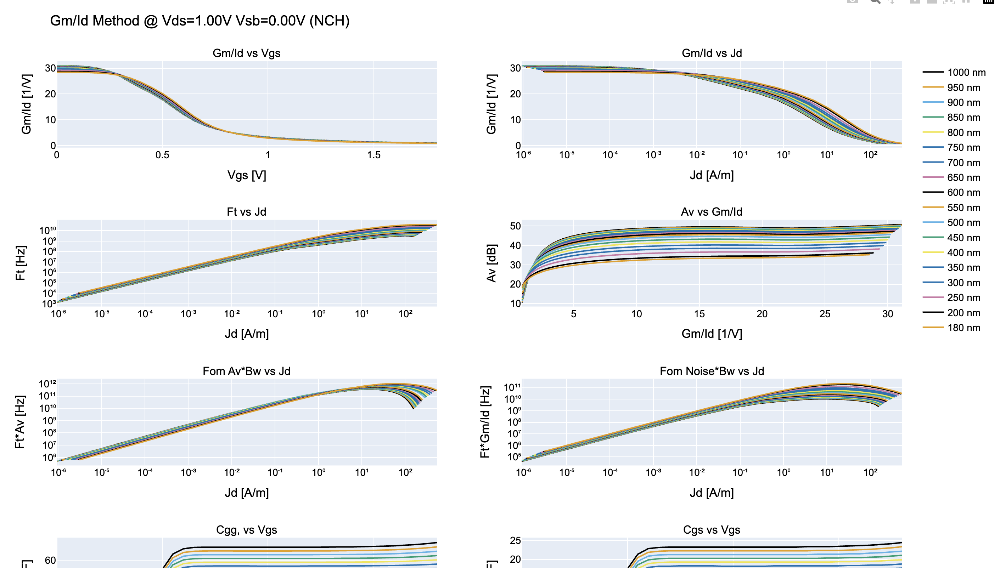
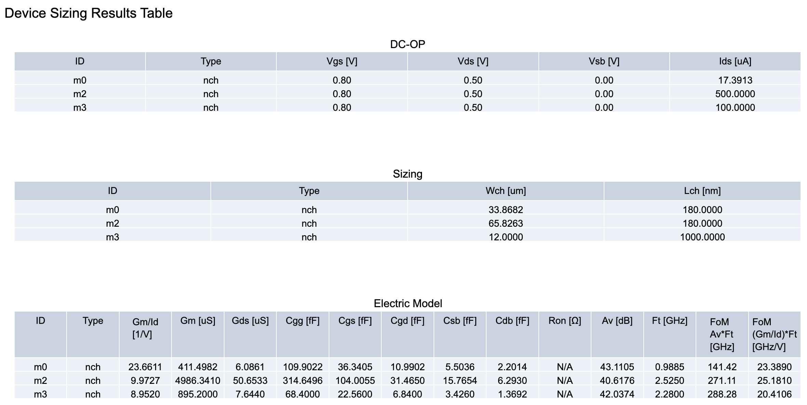

# CLI reference

```text
novaad

LUT-based Analog/Mixed-Signal IC Design Tool using Gm/Id Methodology.

Usage:
  novaad (device | moscap | switch ) -i=INPUT_FILE [-o=OUTPUT_FILE] [--noise] [--gui] [--verbose] [--config=CONFIG_FILE]
  novaad --gui --type=TYPE [--vds=VSB --vsb=VSB --lch-plot LCH_PLOT ...]  [--verbose] [--config=CONFIG_FILE]
  novaad (-h | --help)
  novaad --version
  novaad COMMAND_FILE

Options:
  -h --help                   Show this screen.
  --version                   Show version.
  -i, --input=INPUT_FILE      Input file.
  -o, --output=OUTPUT_FILE    Output file.
  COMMAND_FILE                File with commands to run.
  --gui                       Launch GUI.
  --vds=VDS                   Drain-to-Source Voltage. Default value is LUT mean.
  --vsb=VSB                   Bulk-to-Source Voltage. Default value is LUT minimum.
  --type=TYPE                 Device Type [default: 'nch'].
  --lch-plot                  Channel lengths to include in plot [default: 'all'].
  --noise                     Include noise summary in the analysis.
  --verbose                   Verbose Output.
  --config=CONFIG_FILE        pyproject.toml with a [tool.novaad] section [default: pyproject.toml].
```

!!! tip
    Pass file paths as `--input=FILE` or `-i FILE`. With the short form, `-i=FILE` makes docopt keep the `=` as part of the path.

## Configuration

The CLI is configured from the `[tool.novaad]` table of a `pyproject.toml`. By default it reads `./pyproject.toml`; `--config=path/to/pyproject.toml` selects another file.

```toml title="pyproject.toml"
[tool.novaad]
out_log_path = "./log"             # optional

[tool.novaad.nch]
lut_path = "luts/sg13_lv_nch.csv"  # .csv or .h5
ref_width = 10e-6                  # width the LUT was characterized at [m]

[tool.novaad.pch]
lut_path = "luts/sg13_lv_pch.csv"
ref_width = 10e-6
```

A device type without a table is skipped, with a warning for every instance of that type. LUTs can be `.csv` or `.h5` (HDF5, one top-level key); the format is chosen by the file extension.

## Input file

The input file is TOML with up to four sections. Each key is an instance name and each value is an inline table of targets. All values are in SI units.

```toml title="input.toml"
[device]
m0 = { type = "nch", vds = 0.5, vsb = 0.0, lch = 180e-9, gmid = 26, gm = 1e-3 }
m2 = { type = "nch", vgs = 0.8, vds = 0.5, vsb = 0.0, lch = 180e-9, gmid = 10, ids = 500e-6 }
m3 = { type = "nch", vgs = 0.8, vds = 0.5, vsb = 0.0, lch = 1e-6, wch = 12e-6, ids = 100e-6 }

[noise]
m0 = { t_celsius = 36, noise_fmax = 100e6, flicker_corner_freq = 30e3 }

[moscap]
m6 = { type = "nch", vgs = 0.8, vsb = 0.0, lch = 180e-9, cgg = 1e-14 }
m8 = { type = "nch", vgs = 0.8, vsb = 0.0, lch = 1e-6, wch = 12e-6 }

[switch]
m11 = { type = "nch", vgs = 0.8, vsb = 0.0, lch = 180e-9, ron = 10 }
m14 = { type = "nch", vgs = 0.8, vsb = 0.0, lch = 1e-6, wch = 12e-6 }
```

### `[device]`: transconductors

| key | meaning |
|---|---|
| `type` | `nch` or `pch` |
| `vgs` | gate-source voltage [V] (optional: novaad finds it from `gmid`) |
| `vds` | drain-source voltage [V] |
| `vsb` | source-bulk voltage [V] |
| `lch` | channel length [m] |
| `gmid` | target gm/id [1/V] |
| `gm` *or* `ids` | target transconductance [S] or drain current [A] |
| `wch` | channel width [m] (optional: if given, the device is characterized instead of sized) |

### `[noise]`: noise summary for `[device]` instances

Used with `--noise`. Each instance here must also exist in `[device]`.

| key | meaning |
|---|---|
| `t_celsius` | junction temperature [°C] |
| `noise_fmax` | upper bound of the noise integration [Hz] |
| `flicker_corner_freq` | flicker corner frequency [Hz]; `0.0` ignores flicker noise |

### `[moscap]`: MOS capacitors

| key | meaning |
|---|---|
| `type`, `vgs`, `vsb`, `lch` | as above |
| `cgg` | target total gate capacitance [F] |
| `wch` | channel width [m] (optional: if given, `cgg` is ignored and computed) |

### `[switch]`: MOS switches

| key | meaning |
|---|---|
| `type`, `vgs`, `vsb`, `lch` | as above |
| `ron` | target on-resistance [Ω] |
| `wch` | channel width [m] (optional: if given, `ron` is ignored and computed) |

!!! note
    For `[moscap]` and `[switch]`, `vds` is ignored and set to the minimum `vds` in the LUT. Ideally that is 0 V, if the LUT includes it.

## Commands

=== "Size and print"

    ```bash
    novaad device --input=input.toml
    novaad moscap --input=input.toml
    novaad switch --input=input.toml
    ```

=== "Save to CSV"

    ```bash
    novaad device --input=input.toml --output=devices.csv
    ```

=== "With noise"

    ```bash
    novaad device --input=input.toml --noise
    ```

=== "Batch file"

    `COMMAND_FILE` is a text file with one command per line, without the leading `novaad`:

    ```text title="commands.txt"
    device --input=input.toml
    device --input=input.toml --output=devices.csv
    switch --input=input.toml --output=switches.csv
    ```

    ```bash
    novaad commands.txt
    ```

## GUI

The GUI is a Bokeh page that opens in the browser. It has two modes.

**1. LUT explorer.** Give `--gui` and a device type to get the gm/id design charts. `--lch-plot` restricts the plotted channel lengths. Hovering a curve draws a dashed crosshair, and charts that share an x variable show the same vertical cursor.

```bash
novaad --gui --type=nch
```



**2. Results table.** Add `--gui` to a sizing command to open its results in the browser:

```bash
novaad device --gui --input=input.toml
```


