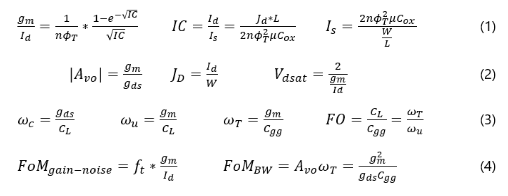

# novaad

**LUT-based gm/id analog/mixed-signal IC design, as a Python library and a CLI.**

novaad sizes MOS transistors with the **gm/id methodology**. It is inspired by [Prof. B. Murmann's gm/id starter kit](https://github.com/bmurmann/Book-on-gm-ID-design/tree/main/starter_kit) and extends it with interpolating look-ups, so it can run inside scripts, notebooks and optimization loops.

{ width="520" }

## What it does

The tool reads a **look-up table (LUT)** of small-signal parameters for each device (NMOS and PMOS), characterized at one reference width over a grid of `vgs × vds × vsb × lch`. Because these parameters scale linearly with width, the table answers two design questions.

-   :material-arrow-right-bold: **Forward problem: sizing**

    ---

    Given a DC operating point (`vds`, `vsb`, optionally `vgs`), a channel length `lch`, a target **gm/id** and a target **gm** or **ids**, novaad returns the width `W`. If `vgs` is not given, it also returns the `vgs` that reaches the target gm/id.

-   :material-arrow-left-bold: **Reverse problem: characterization**

    ---

    Given a DC operating point, `W` and `lch`, novaad returns the device's electrical model: `gm`, `gds`, `cgg`, `cgs`, `cgd`, `cdb`, `csb`, `ft`, intrinsic gain, and the noise estimates.

The gm/id ratio sets the inversion level. The channel length sets the trade-off between intrinsic gain (`gm/gds`) and speed (`gm/cgg`). Both are design knobs, while `W` and `vgs` are outputs.

## Where to go next

-   :material-download: **[Installation](installation.md)**

    Install from PyPI or set up the development environment.

-   :material-rocket-launch: **[Quick start](quickstart.md)**

    Size a transistor from Python and from the command line in five minutes.

-   :material-table: **[LUT extraction](lut-extraction.md)**

    Build the NMOS/PMOS LUTs for the open gf180mcu PDK with an ngspice testbench.

-   :material-chip: **[Examples](examples/index.md)**

    Design a common-source amplifier, a fully-differential amplifier and a voltage buffer, with ngspice verification and pymoo multi-objective optimization.

## License

novaad is released under the [BSD 2-Clause License](https://github.com/das-dias/novaad/blob/master/LICENSE).

## Acknowledgements

- Prof. João Goes, for the reverse use of the gm/id method: getting a device's electrical characteristics from its sizing and DC operating point.
- [Positive Feedback: the gm/id methodology](https://positivefb.com/gm-id-methodology/).
